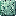
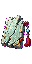

## 当前美术素材

<!-- ART_SECTION:entry-art:START -->

| 素材 | 名称 | ID | 类型 | 尺寸 |
| --- | --- | --- | --- | --- |
|  | 坠天玉砖 | `fallen_heaven_jade_tile` | `tile` | 16x16 |
|  | 破损天碑 | `broken_heaven_tablet` | `object` | 32x64 |

<!-- ART_SECTION:entry-art:END -->

## 美术资源

- Tile：`fallen_heaven_jade_tile`，16x16，白玉砖、残金边线。
- 装饰：`broken_heaven_tablet`，32x64，裂碑和金色铭文。
- 背景：高空宫阙剪影，低饱和金白。
- Prompt 重点：`fallen celestial palace jade tile, broken golden decree lines, Terraria pixel art`。

# 坠天宫阙

[返回生态总览](../Overview.md)

## 概念

坠天宫阙是 Post-Golem 后的天庭残骸生态。它将残天司、化神境和终局路线连接起来。

## 生成

- 阶段：石巨人后解锁对应敌怪与Boss；地形和庭院随新世界生成。
- 当前位置：地下深层坠天玉矿斑及附近遗迹庭院。高空宫阙与天碑传送仍是后续设计。
- 当前结构：最多两座49×23遗迹庭院，三层平整地基、破损顶梁、双侧五格高入口；优先各放置一座破损天碑与归档光柱。更完整的玉阶、悬浮宫砖与天碑终端仍待扩展。
- 危险：沿用已有进度限制的仙傀与天碑卫。庭院不会额外预置无预警陷阱，专门巡逻与机关仍待实现。

## 内容

- 敌怪：仙傀、天碑卫。
- Boss：[天碑守御](../../Bosses/Entries/Heaven_Tablet_Guardian.md)、[残天监察使](../../Bosses/Entries/Broken_Heaven_Inspector.md)。
- 资源：天道碎片、残天玉、破损法旨。
- NPC：[坠天信使](../../NPCs/Entries/Fallen_Heaven_Messenger.md)。

## 代码实现

- ✅ 世界生成骨架（Tile铺设+物件放置）
- ✅ 敌怪生成池（权重与wiki对齐）
- ✅ 环境效果（星渊污染/雷泽落雷/月骨灵压等）
- ✅ 判定阈值（tile count ≥ wiki指定值）

## 遗迹庭院

第296轮起，启用世界生成的新世界会在坠天玉矿斑附近寻找安全天然地形，避开保护结构、人工物件、住房墙、液体和机关。找不到安全位置时跳过，并保留天碑与光柱的既有放置回退；不保证每个候选矿斑都有庭院。庭院自身247块坠天玉足以满足160块生态门槛，不提前解锁敌怪或Boss。

旧世界不补建，加载不修复被拆除的地形或物件。双侧入口只表示庭院内部可进入，不保证通往主洞穴或出生点；高空传送、实际战斗/穿行与真实联机仍待完善和验收。
