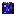
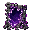

## 当前美术素材

<!-- ART_SECTION:entry-art:START -->

| 素材 | 名称 | ID | 类型 | 尺寸 |
| --- | --- | --- | --- | --- |
|  | 星渊晶岩 | `star_abyss_crystal_tile` | `tile` | 16x16 |
|  | 裂隙膜 | `rift_membrane` | `object` | 32x32 |

<!-- ART_SECTION:entry-art:END -->

## 美术资源

- Tile：`star_abyss_crystal_tile`，16x16，紫黑岩底、深蓝星晶。
- 装饰：`rift_membrane`，32x32，边缘必须硬，不做糊状触手。
- 背景墙：`abyssal_star_wall`，16x16，低亮星点和裂纹。
- Prompt 重点：`void star rift crystal, dark blue infection, Terraria pixel terrain tile`。

# 星渊裂隙

[返回生态总览](../Overview.md)

## 概念

星渊裂隙是 Hardmode 后出现的污染生态。它代表外界星灾侵入玄垣界，提供禁术和高风险装备材料。

## 生成

- 阶段：困难模式解锁对应敌怪与Boss；晶体地形和晶桥洞室随新世界生成。
- 当前位置：地下深层的星渊晶体矿斑附近；陨石坑与世界边缘专属入口仍待扩展。
- 当前结构：晶体矿斑、最多三座45×27双层晶桥洞室，中央完整桥段优先放置裂隙肉膜。上层两处断口各三格宽，下层保留平整落脚地面及独立侧入口。
- 风险：持续暴露会逐步增加灵压，靠近裂隙肉膜也有既有灵压代价；不新增接触伤害陷阱。

## 内容

- 敌怪：星蚀修士、星渊幼体。
- Boss：[星渊胎主](../../Bosses/Entries/Abyssal_Star_Womb.md)。
- 资源：星蚀晶、渊尘、暗蓝灵液。
- 装备：星渊眼、星蚀弩机。

## 代码实现

- ✅ 世界生成骨架（Tile铺设+物件放置）
- ✅ 敌怪生成池（权重与wiki对齐）
- ✅ 环境效果（星渊污染/雷泽落雷/月骨灵压等）
- ✅ 判定阈值（tile count ≥ wiki指定值）

## 环境暴露与死亡

第295轮起，死亡会清除本次星渊环境暴露计时，复活后重新累计。此规则不直接清除已有灵压，也不改变其它死亡惩罚。

## 晶桥洞室

第298轮起，新世界在已有星渊矿斑附近寻找安全位置，避开保护结构、人工物件、住房墙、液体和机关。找不到安全位置时跳过，裂隙肉膜仍可通过原有区域放置回退生成，总目标仍为三座。单座252块晶体满足140块的星渊生态门槛，不提前解锁敌怪或Boss。

上层需要跨越两处断口，下层提供干燥落脚面；入口和断口的角色容身空间已由引擎碰撞检查，实际跳跃、全程洞穴可达性和战斗平衡仍待验收。旧世界不增建，加载不会修复拆除的桥面或肉膜。
