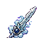

## 当前美术素材

<!-- ART_SECTION:entry-art:START -->

| 素材 | 名称 | ID | 类型 | 尺寸 |
| --- | --- | --- | --- | --- |
|  | 破云飞剑 | `cloudpiercer_flying_sword` | `item_icon` | 64x64 |

<!-- ART_SECTION:entry-art:END -->

## 美术资源

- 详见 [武器与饰品总览](../Overview.md) 中的美术素材表。
- Prompt：Terraria pixel art weapon icon, xianxia theme.

# 破云飞剑

[返回装备总览](../Overview.md)

## 定位

- 英文 ID：`cloudpiercer_flying_sword`
- 阶段：Pre-Hardmode
- 类型：近战/灵气

## 数值

| 属性 | 值 |
|------|-----|
| 伤害 | 28 |
| 使用时间 | 25 |
| 击退 | 3.5 |
| 暴击 | 4% |
| 灵气消耗 | 6 |
| 射速 | 11 |
| 稀有度 | Green |

## 效果

- 飞剑穿透1个敌人，撞击后释放CloudWisp次级投射物。

## 配方

器胚碎片x2 + 青木根x6 + 下品灵石x12 @ 器胚炉

## 法器觉醒

- 境界要求：金丹
- 声望要求：32
- 效果：伤害+10%，灵耗降至5

## 投射物

| 素材 | 类型 | 尺寸 |
| --- | --- | --- |
|  | projectile | 56x24 |

## 代码实现

- ✅ 数值与wiki对齐
- ✅ 配方实现
- ✅ 法器觉醒机制

第274轮：穿云飞剑与云灵绑定权威主人会话，主人死亡、重连或失效后无伤并至多6tick清理。正常飞剑消失只释放一枚速度6、三分之一伤害（至少1）的近战云灵，已发云灵不依赖父剑存活；保留飞剑105tick/两穿透和云灵180tick/单穿透。两弹体各新增1字节状态同步，双方需相同构建。原生正常派生、自然到期、命中和会话清理已验证；真实地形/联机仍待验收。
